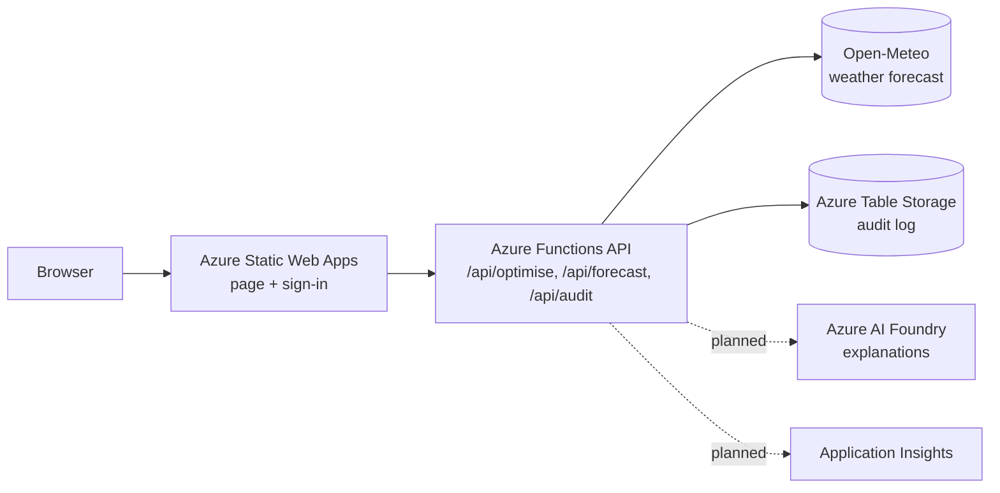

# Facility Energy Planner

Planning tool for commercial and industrial facilities with on-site solar. It forecasts solar output and demand, then plans when to charge or discharge a battery and when to run shiftable equipment, so the facility buys less grid power at the billed peak. Built for the **AI4Sustainability Hackfest 2026** (Leader Energy challenge: *AI-Powered Facility Energy Monitoring and Optimisation Planner*).

**Live demo:** https://white-mud-05f2eb810.1.azurestaticapps.net

> Status: prototype. Demand history is synthetic and the grid emission factor is a placeholder. See [Known limitations](#known-limitations).

## What it does
1. **Customer tariff.** Choose supply voltage (LV, MV, HV) and tariff type (General or Time-of-Use). Rates follow TNB's RP4 non-domestic schedule (ToU peak is 14:00 to 22:00 on weekdays; on ToU, maximum demand is billed on peak-period demand only).
2. **Facility inputs.** Peak demand, load shape, solar size, battery, shiftable share of daytime load, grid import limit, and which assets the customer has.
3. **Forecast.** Optional "use tomorrow's forecast": weather from Open-Meteo, converted to solar output by a PV physics model; demand from a calendar-and-temperature regression.
4. **Optimiser.** A linear program plans every hour: grid import, battery charge and discharge, and where the shiftable load runs (only between 09:00 and 17:00, total energy unchanged).
5. **Digital twin.** Compare a baseline with three strategies: **Cost-saving**, **Balanced**, **Production-first** (nothing is moved). The page shows cost, solar used, grid share, billed peak, CO2 and a plain-language action list.

## Architecture


| Service | Why it is used | Status |
|---|---|---|
| Azure Static Web Apps | Hosts the page, deploys from this repo, built-in GitHub / Microsoft sign-in | In use |
| Azure Functions (Python), managed by Static Web Apps | Runs the optimiser and forecast as small HTTP functions | In use |
| Azure Table Storage | Audit log of every optimiser and forecast call | In code, active when `AUDIT_STORAGE_CONNECTION` is set |
| Application Insights | Monitoring and traces | Planned |
| Separate Function App with managed identity, Key Vault | Production-grade secrets and identity (managed functions in Static Web Apps have no managed identity) | Planned |
| Azure AI Foundry | Plain-language explanations of each plan, with content safety and tracing | Planned |

Services considered and not used: Microsoft Fabric (smallest capacity costs about US$263 a month at pay-as-you-go, far more than one facility needs), Copilot Studio (built for Microsoft 365 chat agents), AKS and VMs (more to manage than the workload needs).

## Where the AI is
- **Forecasting.** Weather forecast plus PV physics for solar. A learned irradiance correction is trained and tested, but it is only used if it beats the plain forecast on held-back days (it did not in the latest run, so it is not used). Demand uses ridge regression on hour, day type and temperature.
- **Optimisation.** A linear program (HiGHS) minimises the real bill. A MILP version with a diesel generator is in `mems_milp.py` (from a university assignment).
- **Explanations.** Planned: a language model that only narrates the optimiser's output and never changes numbers.

## Validation
| Check | Result |
|---|---|
| `mems_milp.py` against the course case study (2006 tariff window) | RM 7,270.09 without diesel and RM 7,125.34 with diesel, both reproduced exactly |
| Dashboard baseline (current RP4 window, same case) | RM 7,080.11, matches the Python model |
| Solar forecast, 28 held-back days, % of installed kWp, 07:00 to 18:00 | Yesterday's output 8.07%; weather forecast + physics 6.07%; learned correction 6.32% (not used) |
| Demand forecast on **synthetic** history | 1.4% to 1.6% vs 2.0% to 2.4% for "same as last week". The pipeline works. This is **not** real-world accuracy. |

"Actual" solar in the test is physics applied to reanalysis weather, not an inverter reading, so the solar numbers measure weather-forecast error only.

## Security and privacy
- Inputs to every endpoint are validated and range-checked.
- The audit log stores a one-way hashed user ID (no email) and the site location rounded to 0.1 degree. Rows are deleted after 30 days (`AUDIT_RETENTION_DAYS`).
- The location sent to the weather service is rounded to about 1 km.
- Demo mode leaves the optimiser open so anyone can try it. Only `/api/audit` needs sign-in. `staticwebapp.config.strict.json` puts the whole API behind sign-in for production.
- Known gap: any signed-in GitHub or Microsoft account counts as "authenticated". A real deployment should restrict the audit log to named roles.

## Run it yourself
```bash
pip install numpy scipy
python mems_milp.py                                    # optimiser checks against the course case study
python tools/forecast_lab.py --forecast-source previous  # train and test the forecasts, writes api/model.json
```
Deployment: pushes to `main` deploy through GitHub Actions to Azure Static Web Apps (`api/` is the function app).

## Repository layout
```
index.html                 dashboard (one file)
staticwebapp.config.json   routes and sign-in rules
api/                       Azure Functions: optimiser, forecast, audit
tools/forecast_lab.py      trains and tests the forecast models
mems_milp.py               MILP with diesel generator (course case study)
```

## Known limitations
- Demand history is synthetic. Real accuracy needs the customer's meter data (the lab accepts a CSV with `timestamp,kw`).
- One repeating weekday. TNB bills the highest 30-minute reading of the month, and the model uses hourly values, so real peaks can be higher than planned. A margin or stress-test mode is planned.
- "Shiftable load" is one pool of energy, not individual machines.
- Battery purchase cost is not in the savings figure. The grid emission factor (0.60 kg/kWh) is a placeholder.
- The retail charge, the 1.6% KWTBB levy and tax are not modelled. Verify all TNB rates against the customer's bill.
- Open-Meteo's free tier is for non-commercial use. A licensed weather source would replace it in production.
- No intraday re-planning, no export income, no diesel or gas in the web optimiser.
