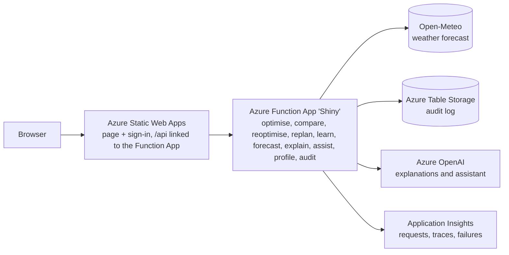

# Sun Shine

Planning tool for commercial and industrial facilities with on-site solar, battery storage and staff EV charging. It forecasts solar output and demand, then compares battery and flexible-load plans against the facility's tariff and grid limit. Built for the **AI4Sustainability Hackfest 2026** (Leader Energy challenge: *AI-Powered Facility Energy Monitoring and Optimisation Planner*).

**Live demo:** https://white-mud-05f2eb810.1.azurestaticapps.net

> Status: prototype. Forecast demand is trained on synthetic data unless a meter CSV is loaded, and the grid emission factor is a placeholder. See [Known limitations](#known-limitations).

## What it does

1. **Customer tariff.** Choose supply voltage (LV, MV, HV) and tariff type (General or Time-of-Use). Rates use TNB's RP4 non-domestic schedule, effective 1 July 2025 through 31 December 2027. For MV ToU, the base energy rates are 31.32 sen/kWh peak and 27.23 sen/kWh off-peak; peak demand is RM97.06/kW-month (RM30.19 capacity + RM66.87 network). AFA is an additional monthly input.
2. **Facility inputs.** Peak demand, load shape, solar size, battery, flexible load, EV chargers and energy, and an optional hard grid-import limit. A year of 30-minute meter readings can be uploaded as a CSV (read in the browser, never uploaded); the maximum demand and the real demand shape are then taken from it.
3. **Forecast.** Weather from Open-Meteo is converted to solar output by a PV physics model; demand uses a calendar-and-temperature regression trained on synthetic history.
4. **Optimiser.** A linear program plans the site's energy use in 30-minute steps (weather is hourly and is smoothed to 30 minutes; the optimiser also accepts hourly input). Staff EV charging is the flexible load and can only run in the facility's operating hours: weekdays 07:30 to 18:00, Saturday 07:30 to 14:00, Sunday closed. Grid import is held under the grid limit (4.2 MW in the demo) as a hard rule. The battery starts the day half full and ends at least half full, with 90% round-trip efficiency.
5. **Digital twin.** Compare solar-only baseline with **Cost-saving** (uses the whole battery), **Balanced** (keeps 20% of the battery in reserve) and **Lowest-carbon** (no extra CO2, keeps 30% in reserve) plans. The reserve keeps the three strategies different even when surplus solar fills the battery for free. The grid limit wins over the reserve: if a hard limit cannot be met with the reserve, the plan is made again without it. The page shows cost, solar use, grid share, billed peak, CO2, a plain-language action list, and a Panel layout view that follows the clock on today's date (a live view of the forecast, not panel measurements).

## Architecture



| Service | Why it is used | Status |
|---|---|---|
| Azure Static Web Apps | Hosts the page, deploys from this repo, built-in GitHub / Microsoft sign-in, forwards `/api` to the linked Function App | In use |
| Azure Function App ("Shiny") | Runs the optimiser, forecast and other HTTP functions from the `api/` folder; deployed by `.github/workflows/deploy-function-app.yml`, which runs the test suite first | In use |
| Azure Table Storage | Audit log of every optimiser and forecast call | In code, active when `AUDIT_STORAGE_CONNECTION` is set |
| Application Insights | Monitoring, request traces and failures for the API; logging and sampling settings are in `api/host.json` | In use (connected to the Function App, confirmed in the Azure portal) |
| Key Vault | Production-grade secret storage | Resource exists in Azure (per owner); this repo does not reference it yet |
| Azure OpenAI | Plain-language plan explanations and setup/navigation assistant | In use (Azure gpt-5-mini deployment) |

Services considered and not used: Microsoft Fabric (smallest capacity costs about US$263 a month at pay-as-you-go, far more than one facility needs), Copilot Studio (built for Microsoft 365 chat agents), AKS and VMs (more to manage than the workload needs).

5. **Fair comparison (`/api/compare`).** The same inputs are run four ways: solar only, a battery with a self-consumption rule, a battery with a simple time-of-use rule, and the optimiser. All use one KPI function (cost, grid energy, billed peak, highest import, solar used and curtailed, time over the grid limit). A battery rule that ends the day below 50% charge is charged for the shortfall, so no strategy borrows from tomorrow.
6. **Re-optimisation simulation (`/api/reoptimise`).** A rolling-horizon *simulation*, not equipment control. A simulated deviation (cloud, demand surge) is applied to the forecast day. The day-ahead plan is followed unchanged or re-planned during the day (on a timer, on a forecast error, or when a new forecast arrives) using only information available at that time. Perfect foresight is shown as an unreachable bound. Both followed strategies share the same reactive grid-limit guard.
7. **Today so far (`/api/replan`).** The user gives measured 30-minute load and solar (optionally battery, EV, grid and battery charge) for the part of today that has passed, or runs a clearly labelled simulated replay. The server measures the forecast error, corrects the rest of the day's forecast by the recent actual/forecast ratio (fading back over about 6 hours), and re-plans from now with the elapsed steps locked. It compares continuing the old plan with the new plan on the same corrected forecast. Recommendation only.
8. **Learning from forecast error (`/api/learn`).** Each half-hour of the day keeps a correction ratio (actual / forecast) for solar and for load. After every full day of measured data the ratios are updated (plain average for the first days, then exponential weighting so recent days count more; one day's ratio is limited to 0.3 to 2.0 before it is learned, and the stored profile stays within 0.2 to 3, so a faulty meter reading cannot ruin it). The profile is kept in the browser, sent with requests, and applied to the forecast in "Today so far". A day cannot be taught twice. A simulated 30-day backtest (day k corrected using days before k only, with a no-peeking test) shows the mechanism: with an injected repeatable error, solar error falls about 58% and load error about 45%, for a real-cost gain of about 1.3%; with no repeatable error (control) there is no gain and slightly more noise. The injected error is part of the test, so this demonstrates the mechanism, not real-world gain.

## Where the AI is

- **Forecasting.** Weather forecast plus PV physics for solar. A learned irradiance correction is trained and tested, but it is only used if it beats the plain forecast on held-back days (it did not in the latest run, so it is not used). Demand uses ridge regression on hour, day type and temperature.
- **Optimisation.** A linear program (HiGHS) minimises the real bill. A MILP version with a diesel generator is in `optimizer/mems_milp.py` (from a university assignment).
- **AI explanations and assistant.** The explanation model only narrates optimiser output and validates numbers in its response. The assistant can propose settings and navigation; the server validates proposals and the user confirms changes.

## Validation

| Check | Result |
|---|---|
| `optimizer/mems_milp.py` against the course case study (2006 tariff window) | RM 7,270.09 without diesel and RM 7,125.34 with diesel, both reproduced exactly |
| Dashboard baseline (current RP4 window, same case) | RM 7,080.11, matches the Python model |
| Solar forecast, 28 held-back days, % of installed kWp, 07:00 to 18:00 | Yesterday's output 8.07%; weather forecast + physics 6.07%; learned correction 6.32% (not used) |
| Demand forecast on **synthetic** history | 1.4% to 1.6% vs 2.0% to 2.4% for "same as last week". The pipeline works. This is **not** real-world accuracy. |

"Actual" solar in the test is physics applied to reanalysis weather, not an inverter reading, so the solar numbers measure weather-forecast error only.

## Security and privacy

- The API handlers validate inputs; the explanation, assistant and profile requests have size limits. In the demo deployment, optimiser and forecast endpoints are public; explanation, assistant, audit and profile endpoints require sign-in.
- The audit log stores a one-way hashed user ID (no email) and the site location rounded to 0.1 degree. Rows are deleted after 30 days (`AUDIT_RETENTION_DAYS`).
- The location sent to the weather service is rounded to about 1 km.
- Demo mode leaves the optimiser and forecast endpoints open so anyone can try them. /api/explain, /api/assist, /api/audit and /api/profile need sign-in. /api/compare (60 per minute per client) and /api/reoptimise and /api/replan (20 per minute per client each) and /api/learn (10 per minute) have an in-process rate limit and a 200 KB body cap; like the AI limits it is per server instance, not a deployment-wide quota. Review access controls and add shared rate limiting before production use.
- Known gap: any signed-in GitHub or Microsoft account counts as "authenticated". A real deployment should restrict the audit log to named roles.

## Run it yourself

```bash
pip install numpy scipy
cd api
python test_optimiser.py       # optimiser checks (15)
python test_ev_limit.py        # EV operating window and grid limit (29)
python test_reserve.py         # battery reserve (8)
python test_halfhourly.py      # 30-minute steps (13)
python test_forecast.py        # forecast checks (11)
python test_reference.py       # fair comparison and fixed-step checks (34)
python test_reopt.py           # re-optimisation simulation (44)
python test_live.py            # today-so-far re-plan (47)
python test_learn.py           # error learning (38)
python test_explain.py         # AI explanation guardrails (33)
python test_assist.py          # assistant guardrails (30)
python test_ratelimit.py       # rate limiter (9)
python test_reference_data.py  # reference data checks (prints nothing when it passes)
cd ..
python optimizer/mems_milp.py                              # optimiser checks against the course case study
python tools/forecast_lab.py --forecast-source previous    # train and test the forecasts, writes api/model.json
```

Deployment: a push to `main` runs two GitHub Actions workflows. The Static Web Apps workflow publishes `index.html`. The Function App workflow (`deploy-function-app.yml`) runs the tests and then deploys `api/` to the Function App "Shiny". Both must succeed for a change to be live; an API change (for example the optimiser) is not live until the Function App workflow is green.

## Repository layout

```
index.html                 dashboard (one file)
staticwebapp.config.json   routes and sign-in rules
api/                       Azure Functions: optimiser, forecast, AI, profiles, audit
tools/forecast_lab.py      trains and tests the forecast models
optimizer/mems_milp.py     MILP with diesel generator (course case study)
```

## Known limitations

- Demand history is synthetic. Real accuracy needs the organisers' data or customer meter data; the lab accepts a CSV with `timestamp,kw`.
- Weather is hourly and is smoothed to 30-minute steps. TNB bills the highest 30-minute reading, so real billed peaks need real 30-minute meter data (the CSV upload).
- The EV chargers are one pool of energy inside the operating window, not individual vehicles with arrival and departure times. Public holidays are not modelled.
- The battery reserve levels (0%, 20%, 30%) are design choices, not measured values. The simple battery rules in the fair comparison do not apply a reserve.
- The Panel layout live view follows the clock but shows the solar forecast shared across the panels with a small made-up spread, not per-panel readings.
- Battery purchase cost is not in the savings figure. The grid emission factor (0.60 kg/kWh) is a placeholder: replace it with the current Energy Commission figure for Peninsular Malaysia (provisional 2024 value about 0.74 kg/kWh, check the latest release) in My facility.
- The retail charge, the 1.6% KWTBB levy and tax are not modelled. AFA changes monthly; confirm the tariff category and bill adjustments against the customer's bill.
- Open-Meteo's free tier is for non-commercial use. A licensed weather source would replace it in production.
- Re-planning is a simulation with a fading-persistence correction (6 h, chosen on a few synthetic scenarios). It helps clearly when solar falls short under Cost-saving, but is not guaranteed to win: with the CO2 cap (Balanced, Lowest-carbon) or demand surprises it can be slightly worse. No export income, no diesel or gas in the web optimiser.
