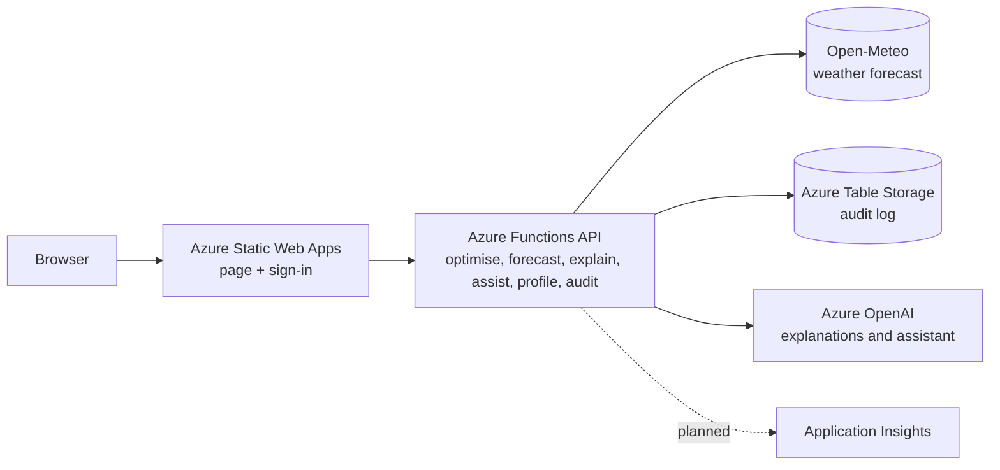

# Sun Shine

Planning tool for commercial and industrial facilities with on-site solar, battery storage and staff EV charging. It forecasts solar output and demand, then compares battery and flexible-load plans against the facility's tariff and grid limit. Built for the **AI4Sustainability Hackfest 2026** (Leader Energy challenge: *AI-Powered Facility Energy Monitoring and Optimisation Planner*).

**Live demo:** https://white-mud-05f2eb810.1.azurestaticapps.net

> Status: prototype. Forecast demand is trained on synthetic data, and the grid emission factor is a placeholder. See [Known limitations](#known-limitations).

## What it does

1. **Customer tariff.** Choose supply voltage (LV, MV, HV) and tariff type (General or Time-of-Use). Rates use TNB's RP4 non-domestic schedule, effective 1 July 2025 through 31 December 2027. For MV ToU, the base energy rates are 31.32 sen/kWh peak and 27.23 sen/kWh off-peak; peak demand is RM97.06/kW-month (RM30.19 capacity + RM66.87 network). AFA is an additional monthly input.
2. **Facility inputs.** Peak demand, load shape, solar size, battery, flexible load, EV chargers and energy, and an optional hard grid-import limit.
3. **Forecast.** Weather from Open-Meteo is converted to solar output by a PV physics model; demand uses a calendar-and-temperature regression trained on synthetic history.
4. **Optimiser.** A linear program plans the site's energy use. The current dashboard and forecast pipeline use 24 hourly values; the optimiser accepts hourly or half-hourly input. Flexible load is currently scheduled 09:00 to 17:00, and the EV model supports facility operating windows.
5. **Digital twin.** Compare solar-only baseline with **Cost-saving**, **Balanced**, and **Production-first** plans. The page shows cost, solar use, grid share, billed peak, CO2, and a plain-language action list.

## Architecture



| Service | Why it is used | Status |
|---|---|---|
| Azure Static Web Apps | Hosts the page, deploys from this repo, built-in GitHub / Microsoft sign-in | In use |
| Azure Functions (Python), managed by Static Web Apps | Runs the optimiser and forecast as small HTTP functions | In use |
| Azure Table Storage | Audit log of every optimiser and forecast call | In code, active when `AUDIT_STORAGE_CONNECTION` is set |
| Application Insights | Monitoring and traces | Planned |
| Separate Function App with managed identity, Key Vault | Production-grade secrets and identity (managed functions in Static Web Apps have no managed identity) | Planned |
| Azure OpenAI | Plain-language plan explanations and setup/navigation assistant | In use (Azure gpt-5-mini deployment) |

Services considered and not used: Microsoft Fabric (smallest capacity costs about US$263 a month at pay-as-you-go, far more than one facility needs), Copilot Studio (built for Microsoft 365 chat agents), AKS and VMs (more to manage than the workload needs).

## Where the AI is

- **Forecasting.** Weather forecast plus PV physics for solar. A learned irradiance correction is trained and tested, but it is only used if it beats the plain forecast on held-back days (it did not in the latest run, so it is not used). Demand uses ridge regression on hour, day type and temperature.
- **Optimisation.** A linear program (HiGHS) minimises the real bill. A MILP version with a diesel generator is in `mems_milp.py` (from a university assignment).
- **AI explanations and assistant.** The explanation model only narrates optimiser output and validates numbers in its response. The assistant can propose settings and navigation; the server validates proposals and the user confirms changes.

## Validation

| Check | Result |
|---|---|
| `mems_milp.py` against the course case study (2006 tariff window) | RM 7,270.09 without diesel and RM 7,125.34 with diesel, both reproduced exactly |
| Dashboard baseline (current RP4 window, same case) | RM 7,080.11, matches the Python model |
| Solar forecast, 28 held-back days, % of installed kWp, 07:00 to 18:00 | Yesterday's output 8.07%; weather forecast + physics 6.07%; learned correction 6.32% (not used) |
| Demand forecast on **synthetic** history | 1.4% to 1.6% vs 2.0% to 2.4% for "same as last week". The pipeline works. This is **not** real-world accuracy. |

"Actual" solar in the test is physics applied to reanalysis weather, not an inverter reading, so the solar numbers measure weather-forecast error only.

## Security and privacy

- The API handlers validate inputs; the explanation, assistant and profile requests have size limits. The optimiser and AI endpoints are anonymously callable in the demo deployment.
- The audit log stores a one-way hashed user ID (no email) and the site location rounded to 0.1 degree. Rows are deleted after 30 days (`AUDIT_RETENTION_DAYS`).
- The location sent to the weather service is rounded to about 1 km.
- Demo mode leaves the optimiser and AI endpoints open so anyone can try them. `/api/audit` and `/api/profile` need sign-in. Review access controls and add shared rate limiting before production use; the current in-process AI limits are not a deployment-wide quota.
- Known gap: any signed-in GitHub or Microsoft account counts as "authenticated". A real deployment should restrict the audit log to named roles.

## Run it yourself

```bash
pip install numpy scipy
python mems_milp.py                                    # optimiser checks against the course case study
python tools/forecast_lab.py --forecast-source previous  # train and test the forecasts, writes api/model.json
```

Deployment: pushes to `main` deploy through GitHub Actions to Azure Static Web Apps (`api/` is the function app).

## Repository layout

```
index.html                 dashboard (one file)
staticwebapp.config.json   routes and sign-in rules
api/                       Azure Functions: optimiser, forecast, AI, profiles, audit
tools/forecast_lab.py      trains and tests the forecast models
mems_milp.py               MILP with diesel generator (course case study)
```

## Known limitations

- Demand history is synthetic. Real accuracy needs the organisers' data or customer meter data; the lab accepts a CSV with `timestamp,kw`.
- The page is hourly. TNB bills the highest 30-minute reading, so billed peaks can be higher than this plan's hourly average until the half-hour pipeline is complete.
- "Shiftable load" is one pool of energy, not individual machines.
- Battery purchase cost is not in the savings figure. The grid emission factor (0.60 kg/kWh) is a placeholder.
- The retail charge, the 1.6% KWTBB levy and tax are not modelled. AFA changes monthly; confirm the tariff category and bill adjustments against the customer's bill.
- Open-Meteo's free tier is for non-commercial use. A licensed weather source would replace it in production.
- No intraday re-planning, no export income, no diesel or gas in the web optimiser.
