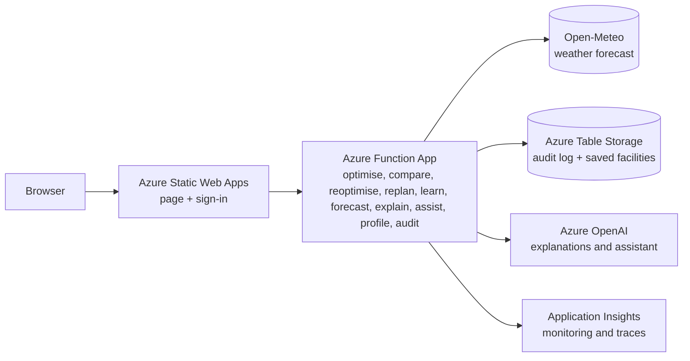

# Sun Shine

Planning tool for commercial and industrial facilities with on-site solar, battery storage and staff EV charging. It forecasts solar output and demand, then compares battery and flexible-load plans against the facility's tariff and grid limit. Built for the **AI4Sustainability Hackfest 2026** (Leader Energy challenge: *AI-Powered Facility Energy Monitoring and Optimisation Planner*).

**Live demo:** https://white-mud-05f2eb810.1.azurestaticapps.net

> Status: prototype. Forecast demand is trained on synthetic data. See [Known limitations](#known-limitations).

## What it does

1. **Customer tariff.** Choose supply voltage (LV, MV, HV) and tariff type (General or Time-of-Use). Rates use TNB's RP4 non-domestic schedule, effective 1 July 2025 through 31 December 2027. For MV ToU, the base energy rates are 31.32 sen/kWh peak and 27.23 sen/kWh off-peak; peak demand is RM97.06/kW-month (RM30.19 capacity + RM66.87 network). AFA is an additional monthly input.
2. **Facility inputs.** Peak demand, load shape, solar size, battery, flexible load, EV chargers and energy, an optional hard grid-import limit, and the panel layout (arrays, rows, panels per row, inverter type). A 30-minute meter CSV can be uploaded to replace the modelled demand. Signed-in users can save facilities to their account.
3. **Forecast.** Weather from Open-Meteo is converted to solar output by a PV physics model; demand uses a calendar-and-temperature regression trained on synthetic history.
4. **Optimiser.** A linear program plans the site's energy use in 30-minute steps, the interval TNB bills. The weather forecast is hourly and is smoothed to 30 minutes (`/api/forecast?res=2`), so demand is only truly 30-minute when a 30-minute meter file is loaded. Flexible load is scheduled 09:00 to 17:00, and EV charging follows the facility's operating window.
5. **Digital twin.** Compare a solar-only baseline with three optimiser strategies. The page shows cost, solar use, grid share, billed peak, CO2 emission, and a plain-language action list. The Day, Week and Month views show the same strategies over longer periods. The **Energy usage** chart follows the clock on today (a live view of the forecast, with a moving "now" line) and the **Daily plan** chart shows the planned battery and grid use.

| Strategy | Battery reserve | Extra grid CO2 allowed | Equipment moved | Idea |
|---|---|---|---|---|
| **Cost-saving** | 0% | No limit | All of it | Lowest bill, uses the whole battery |
| **Balanced** | 20% | Half of what Cost-saving would add | Half as much | Safety margin for outages and forecast error |
| **Lowest-carbon** | 30% | None | All of it (EV charging still shifts) | Never adds grid energy, so it keeps a bigger cushion |

The reserve is the share of the battery that is never used during the day. The battery still starts the day half full and ends at least half full. **The grid limit always wins:** if keeping the reserve would make a hard grid limit impossible, the plan is calculated again without the reserve and the result is marked `reserve_relaxed`. Without the reserve rule, all three strategies would give an identical plan on a sunny day with surplus solar (the surplus fills the battery for free, so cost and carbon stop competing). If the strategies are still identical on a day, the page says why and points to the Battery size sweep (Advanced). On a day with no solar surplus, Lowest-carbon can save close to nothing, because it may not add grid energy.
6. **Panel layout.** A visual layout of the solar panels. On today it follows the clock (**Live** button, on by default; dragging the slider switches it off). It is a live view of the forecast, not live panel data: the values are the shared solar forecast with a small made-up spread and two made-up weak panels. Real per-panel readings would need a micro-inverter or optimiser data feed.
7. **Shiny assistant and guided tour.** A chat assistant (Azure OpenAI) that can propose facility settings and navigation, and a popup tour that highlights each section. A Brief / Detailed switch hides or shows the technical tabs.

## Architecture



| Service | Why it is used | Status |
|---|---|---|
| Azure Static Web Apps | Hosts the page, deploys from this repo, built-in GitHub / Microsoft sign-in | In use |
| Azure Function App (Python) | Runs the optimiser, forecast and other HTTP functions from the api/ folder. Deployed by the `Deploy API to Function App` GitHub Action (tests must pass first) and linked to the Static Web App | In use |
| Azure Table Storage | Audit log of every optimiser and forecast call, and each signed-in user's saved facilities | In use (needs `AUDIT_STORAGE_CONNECTION` or `AUDIT_STORAGE_ACCOUNT_URL` on the app that runs the API) |
| Application Insights | Monitoring and traces. The logging settings are in `api/host.json`; the audit module also writes a structured log line for every call | In use |
| Key Vault | Production-grade secrets | Resource exists in Azure (per owner); the repo code does not read from it yet |
| Azure OpenAI | Plain-language plan explanations and setup/navigation assistant | In use (Azure gpt-5-mini deployment; key or managed identity, see `api/aoai.py`) |

Services considered and not used: Microsoft Fabric (smallest capacity costs about US$263 a month at pay-as-you-go, far more than one facility needs), Copilot Studio (built for Microsoft 365 chat agents), AKS and VMs (more to manage than the workload needs).

## Planning and re-planning tools

1. **Fair comparison (`/api/compare`).** The same inputs are run four ways: solar only, a battery with a self-consumption rule, a battery with a simple time-of-use rule, and the optimiser. All use one KPI function (cost, grid energy, billed peak, highest import, solar used and curtailed, time over the grid limit). A battery rule that ends the day below 50% charge is charged for the shortfall, so no strategy borrows from tomorrow.
2. **Re-optimisation simulation (`/api/reoptimise`).** A rolling-horizon *simulation*, not equipment control. A simulated deviation (cloud, demand surge) is applied to the forecast day. The day-ahead plan is followed unchanged or re-planned during the day (on a timer, on a forecast error, or when a new forecast arrives) using only information available at that time. Perfect foresight is shown as an unreachable bound. Both followed strategies share the same reactive grid-limit guard.
3. **Today so far (`/api/replan`).** The user gives measured 30-minute load and solar (optionally battery, EV, grid and battery charge) for the part of today that has passed, or runs a clearly labelled simulated replay. The server measures the forecast error, corrects the rest of the day's forecast by the recent actual/forecast ratio (fading back over about 6 hours), and re-plans from now with the elapsed steps locked. It compares continuing the old plan with the new plan on the same corrected forecast. Recommendation only.
4. **Learning from forecast error (`/api/learn`).** Each half-hour of the day keeps a correction ratio (actual / forecast) for solar and for load. After every full day of measured data the ratios are updated (plain average for the first days, then exponential weighting so recent days count more; ratios are limited to 0.2 to 3). The profile is kept in the browser, sent with requests, and applied to the forecast in "Today so far". A day cannot be taught twice. A simulated 30-day backtest (day k corrected using days before k only, with a no-peeking test) shows the mechanism: with an injected repeatable error, solar error falls about 58% and load error about 45%, for a real-cost gain of about 1.3%; with no repeatable error (control) there is no gain and slightly more noise. The injected error is part of the test, so this demonstrates the mechanism, not real-world gain.

## Where the AI is

- **Forecasting.** Weather forecast plus PV physics for solar. A learned irradiance correction is trained and tested, but it is only used if it beats the plain forecast on held-back days (it did not in the latest run, so it is not used). Demand uses ridge regression on hour, day type and temperature.
- **Optimisation.** A linear program (HiGHS) minimises the real bill. A MILP version with a diesel generator is in `mems_milp.py` (from a university assignment).
- **AI explanations and assistant.** The explanation model only narrates optimiser output and validates numbers in its response. The assistant can propose settings and navigation; the server validates proposals and the user confirms changes.

## Validation

| Check | Result |
|---|---|
| `mems_milp.py` against the course case study (2006 tariff window) | RM 7,270.09 without diesel and RM 7,125.34 with diesel, both reproduced exactly |
| Dashboard baseline (current RP4 window, same case) | RM 7,080.11, matches the Python model |
| Solar forecast, 28 held-back days, % of installed kWp, 07:00 to 18:00 | Yesterday's output 8.07%; weather forecast + physics 6.07%; learned correction 6.32% (not used) |
| Demand forecast on **synthetic** history | 1.4% to 1.6% vs 2.0% to 2.4% for "same as last week". The pipeline works. This is **not** real-world accuracy. |

"Actual" solar in the test is physics applied to reanalysis weather, not an inverter reading, so the solar numbers measure weather-forecast error only.

## Security and privacy

- The API handlers validate inputs; the explanation, assistant and profile requests have size limits. In the demo deployment, optimiser and forecast endpoints are public; explanation, assistant, audit and profile endpoints require sign-in.
- The audit log stores a one-way hashed user ID (no email) and the site location rounded to 0.1 degree. Rows are deleted after 30 days (`AUDIT_RETENTION_DAYS`).
- The location sent to the weather service is rounded to about 1 km.
- Demo mode leaves the optimiser and forecast endpoints open so anyone can try them. /api/explain, /api/assist, /api/audit and /api/profile need sign-in. /api/compare (60 per minute per client) and /api/reoptimise and /api/replan (20 per minute per client each) and /api/learn (10 per minute) have an in-process rate limit and a 200 KB body cap; like the AI limits it is per server instance, not a deployment-wide quota. Review access controls and add shared rate limiting before production use.
- Known gap: any signed-in GitHub or Microsoft account counts as "authenticated". A real deployment should restrict the audit log to named roles.

## Run it yourself

```bash
pip install numpy scipy
cd api
python test_optimiser.py       # optimiser basics (15)
python test_halfhourly.py      # 30-minute input checks (13)
python test_reserve.py         # battery reserve checks (8)
python test_ev_limit.py        # EV window and grid limit checks (29)
python test_reference.py       # fair comparison and fixed-step checks (34)
python test_reopt.py           # re-optimisation simulation checks (44)
python test_live.py            # today-so-far re-plan checks (47)
python test_learn.py           # error-learning checks (38)
python test_forecast.py        # forecast checks (11)
python test_explain.py         # explanation checks (33)
python test_assist.py          # assistant checks (30)
python test_ratelimit.py       # rate limiter checks (9)
cd ..
python optimizer/mems_milp.py                            # optimiser checks against the course case study
python tools/forecast_lab.py --forecast-source previous  # train and test the forecasts, writes api/model.json
```

`test_reference_data.py` is a shared test day, not a test.

Deployment: pushes to `main` deploy the page to Azure Static Web Apps through GitHub Actions. Pushes that change `api/` run every `test_*.py` and then deploy the API to the Azure Function App (`.github/workflows/deploy-function-app.yml`). **Deploy the backend as well as the page**: if only `index.html` is deployed, the page sends the reserve but an old server ignores it, and the strategies stay identical without any error message.

## Repository layout

```
index.html                 dashboard (one file)
shiny.png                  Shiny assistant picture
staticwebapp.config.json   routes and sign-in rules
api/                       Azure Functions: optimiser, forecast, AI, profiles, audit, and test_*.py
tools/forecast_lab.py      trains and tests the forecast models
optimizer/mems_milp.py     MILP with diesel generator (course case study)
.github/workflows/         page deployment and API deployment
```

## Known limitations

- Demand history is synthetic. Real accuracy needs the organisers' data or customer meter data; the lab accepts a CSV with `timestamp,kw`.
- Planning uses 30-minute steps, the interval TNB bills, but the weather forecast is hourly and smoothed. Demand is only truly 30-minute with a 30-minute meter file.
- "Shiftable load" is one pool of energy, not individual machines.
- Battery purchase cost is not in the savings figure. CO2 uses one flat grid emission factor, 0.74 kg/kWh by default (Peninsular Malaysia, 2024, Energy Commission *Grid Emission Factor in Malaysia 2022-2024*, provisional, published 23 Feb 2026). It is an annual average, so it cannot tell cleaner hours from dirtier ones.
- The retail charge, the 1.6% KWTBB levy and tax are not modelled. AFA changes monthly; confirm the tariff category and bill adjustments against the customer's bill.
- Open-Meteo's free tier is for non-commercial use. A licensed weather source would replace it in production.
- Re-planning is a simulation with a fading-persistence correction (6 h, chosen on a few synthetic scenarios). It helps clearly when solar falls short under Cost-saving, but is not guaranteed to win: with the CO2 cap (Balanced, Lowest-carbon) or demand surprises it can be slightly worse. No export income, no diesel or gas in the web optimiser.
- The reserve levels (0%, 20%, 30%) are design choices, not measured values; a customer would set them from their own outage and backup needs. A reserve holds back some peak shaving, so Cost-saving is the cheapest of the three by design.
- The Fair comparison table's simple battery rules do not apply a reserve, so the optimiser can look a little more expensive than them on some days.
- There is no export of surplus solar. Surplus that cannot be used or stored is wasted, which is why battery size matters.
